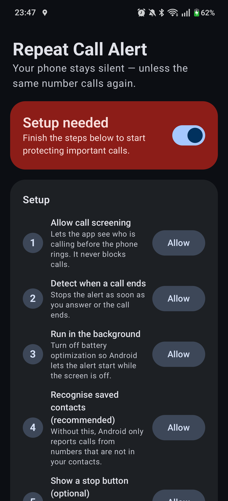

# Repeat Call Alert

**Keep your phone on silent, but don't miss urgent calls.** If the same number calls you again within a few
minutes, Repeat Call Alert lets that call ring, even when your phone is on silent, on vibrate, or has the
OnePlus **Alert Slider** set to silent.

Android has a built-in "repeat callers" option, but it only works inside Do Not Disturb. On OnePlus phones the
physical Alert Slider's silent mode overrides it. This app fills that gap.

<p align="center"></p>

## Features

- Rings on the **2nd call** (configurable up to the 5th) from the same number within **5 minutes** (configurable 1–30 min)
- Works with **silent mode, vibrate, Do Not Disturb, and the OnePlus Alert Slider**
- Plays **your own ringtone**. It stops the moment you answer or decline, or when the caller hangs up (60 s at most)
- Raises the alarm volume to a minimum you choose for that call, then restores it
- **Never blocks or rejects calls**: it only listens
- **Private**: no internet permission, no analytics, no account. Numbers are stored only as salted hashes, on your phone, for 35 minutes at most. See [SECURITY.md](SECURITY.md)
- Free and open source (MIT)

## Installation guide

Requires **Android 12 or newer**.

### 1. Download and install

1. On your phone, open the **[latest release](../../releases/latest)** and download `repeat-call-alert-<version>.apk`.
2. Open the downloaded file. Android asks you to allow installs from your browser or file manager:
   tap **Settings**, turn on **Allow from this source**, go back and tap **Install**.
3. If Google Play Protect warns about an unknown app, tap **More details → Install anyway**.
   (The app is not on the Play Store; the source code is right here.)

### 2. Set it up (takes about a minute)

Open **Repeat Call Alert** and work through the **Setup** card:

| Step | What to tap | Why |
|---|---|---|
| 1. Allow call screening | **Allow** → choose *Repeat Call Alert* as your caller ID & spam app | The app sees who is calling *before* the phone rings. It always lets the call through. Only one app can hold this role. If you already use another call screening app, it will replace it. |
| 2. Detect when a call ends | **Allow** | Stops the sound as soon as you answer or the call ends |
| 3. Run in the background | **Allow** | Without this, Android may refuse to start the sound while the screen is off |
| 4. Recognise saved contacts | **Allow** (recommended) | Android only passes calls from contacts to the app with this permission |
| 5. Show a stop button | **Allow** (optional) | Adds a *Stop* button to the notification |

When the top card says **Active**, you're done.

### 3. OnePlus / OxygenOS / ColorOS extra step (recommended)

These phones close background apps aggressively. Open the app's **Settings → Apps → Repeat Call Alert → Battery** and select
**Unrestricted** (or **Allow background activity**). The *Open app info* button in the app takes you there.

Some other brands (Xiaomi, Samsung, Huawei) have similar settings. [dontkillmyapp.com](https://dontkillmyapp.com) explains them per brand.

### 4. Test it

1. Set your phone to **silent** (Alert Slider to silent on OnePlus).
2. In the app, tap **Play test alert**. You should hear your ringtone for 5 seconds.
3. Real test: from another phone, call yourself, hang up, and call again within 5 minutes. The second call should ring.

The **Activity** card in the app shows what happened for each call.

## How it works

1. The app holds Android's official [call screening role](https://developer.android.com/reference/android/telecom/CallScreeningService).
   Android asks it about each incoming call *before ringing*. The app answers "allow" within milliseconds.
2. It remembers when each number called (as a hash). On a repeated call it checks whether your phone is silenced.
3. If so, it starts a short foreground service that plays your ringtone on the **alarm** audio channel.

**Why the alarm channel?** On OnePlus phones (tested on a OnePlus 12, OxygenOS 16), the system refuses any app request to switch
the ringer back on while the Alert Slider is on silent (`AudioServiceExtImpl: setRingerMode … is not allowed`),
even with Do Not Disturb access, and even over ADB. The media channel can't be used either: during an incoming call it doesn't get
audio focus. Silent mode never mutes alarms, so the alarm channel reliably makes the call heard.

## Limitations

- It is your ringtone on the alarm channel, not the system's own ring. The loudness follows your **alarm volume**
  (raised to your chosen minimum).
- Withheld/private numbers can't be matched.
- It doesn't work until you unlock the phone for the first time after a reboot.
- With Bluetooth audio connected, the alert may play through that device.
- Only one call screening app can be active at a time.

## Tested on

| Device | Android / OS | Result |
|---|---|---|
| OnePlus 12 (CPH2581) | Android 16, OxygenOS 16.0.10 | Second call audible with Alert Slider on silent; stops on answer and on hang-up |

Tried it on another phone? Please [share your result](../../issues/new?template=device_report.md), whether it worked or not.

## Ideas and feature requests welcome 💡

This app started as a fix for one person's problem, and it can grow into whatever is useful for you.
**Feel free to ask for features.** For example: always letting certain contacts ring, quiet hours, vibration, a different
sound, or support for your phone model. Nothing is too small.

- 👉 **[Suggest a feature](../../issues/new?template=feature_request.md)**
- 🐞 **[Report a problem](../../issues/new?template=bug_report.md)**
- 💬 Or just open an [issue](../../issues) with a question

You don't need to know how to code. Describe what you'd like to happen, and I'll see what's possible.
Pull requests are welcome too.

## Build from source

```bash
git clone https://github.com/jim-spijker/repeat-call-alert.git
cd repeat-call-alert
./gradlew testDebugUnitTest assembleDebug
adb install -r app/build/outputs/apk/debug/app-debug.apk
```

You need JDK 17+ and the Android SDK (compileSdk 37). It builds with Gradle 9.4.1 and AGP 9.2.1, uses Kotlin and Jetpack Compose, and stores data with DataStore.
To make signed release builds, set `RCA_STORE_FILE`, `RCA_STORE_PASSWORD`, `RCA_KEY_ALIAS` and `RCA_KEY_PASSWORD` in
`~/.gradle/gradle.properties`.

## License

[MIT](LICENSE). Not affiliated with OnePlus, Google, or any phone maker.
